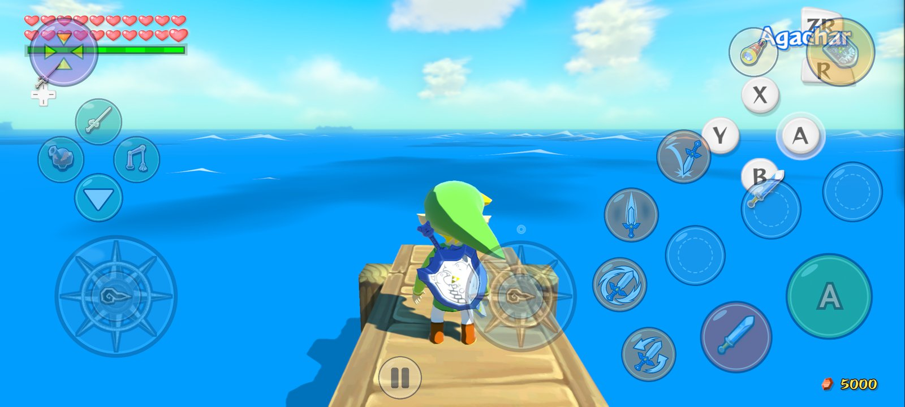
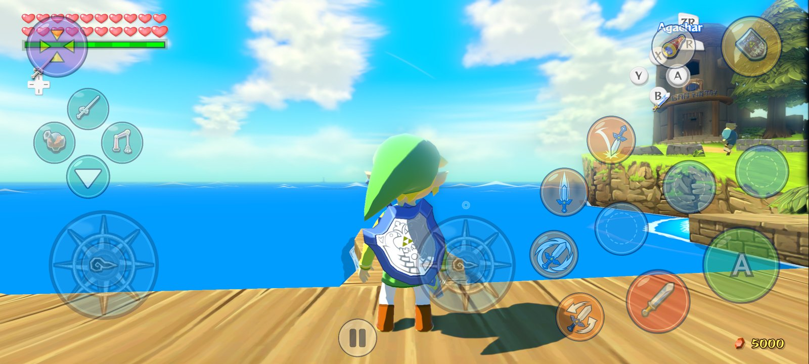
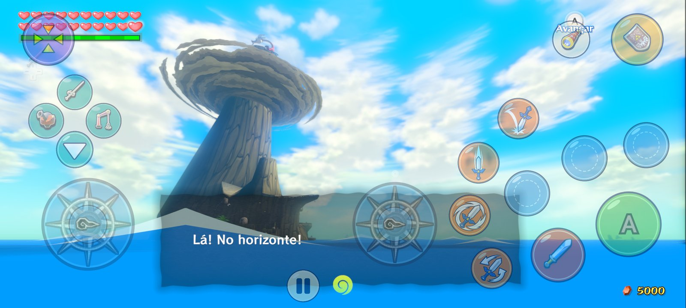
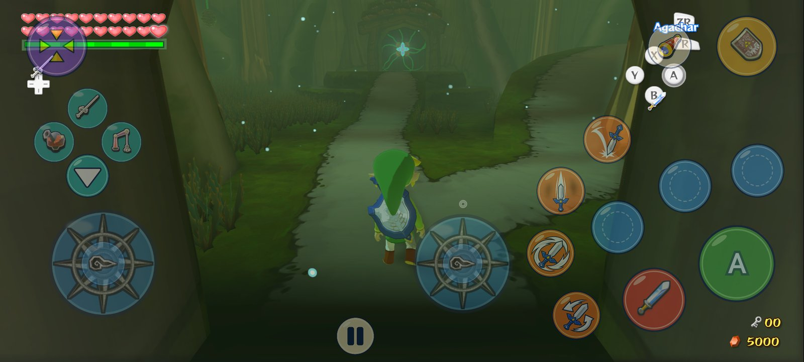
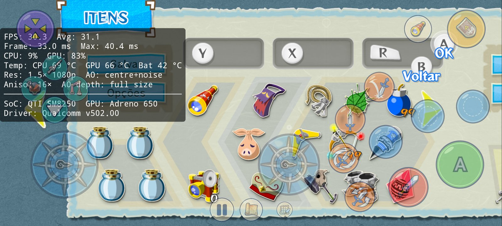
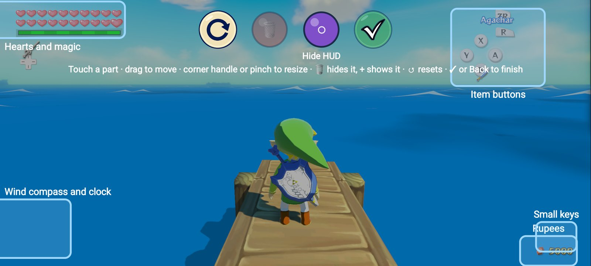
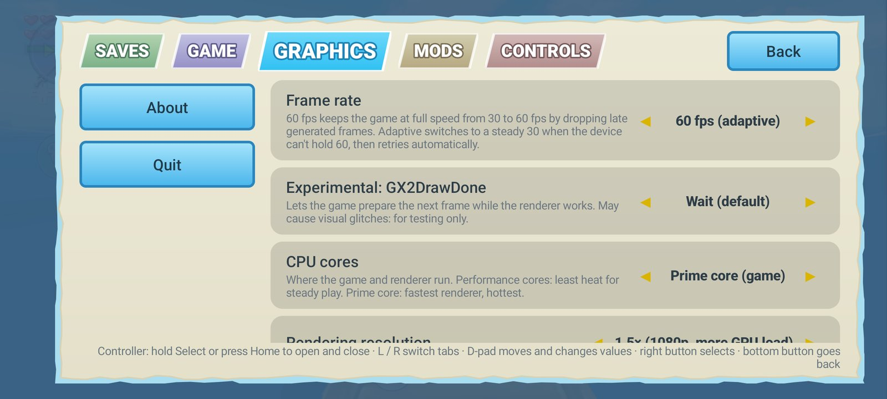
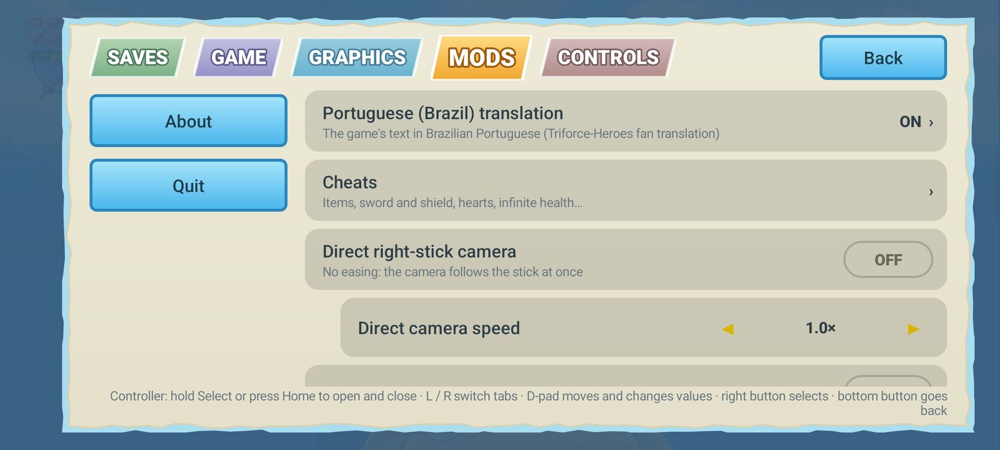

# Wind Waker HD Recompiled for Android — Plus

**The Legend of Zelda: The Wind Waker HD**, running natively on Android phones and tablets.
This is a static recompilation of the Wii U game: its PowerPC code is turned into native ARM64 code
on your device, and its graphics run directly on Vulkan. It is **not an emulator**.

**Plus** builds on the [Enhanced](https://github.com/SSunnKing/ZeldaWWHDRecompAndroid---ENHANCED)
fork of the [Android port](https://github.com/GreenNaugahyde/ZeldaWWHDRecompAndroid). It adds a
built-in Brazilian Portuguese translation, an app fully translated into Portuguese, a HUD layout
editor, `.wua` archive support, better controller support, menus that fit any screen, and fixes
for crashes on Adreno 650 and on 6 GB phones.

> **You need your own copy of the game.** The app contains no game code, no game files and no
> keys. You provide a dump of your own Wii U disc (`.wud` / `.wux` with its keys) or a Cemu
> archive of it (`.wua`).

<p align="center">
  
  
  
  
</p>

<p align="center"><sub>Screenshots taken on a Samsung Galaxy S20 FE 5G (Snapdragon 865), full screen at 2400 × 1080.</sub></p>

---

## Contents

- [Download](#download)
- [What's new in Plus](#whats-new-in-plus)
- [Getting started](#getting-started)
- [How to play](#how-to-play)
- [Settings guide](#settings-guide)
- [Performance](#performance)
- [Troubleshooting](#troubleshooting)
- [Building from source](#building-from-source)
- [Credits](#credits)
- [Legal notice](#legal-notice)

---

## Download

Get the latest APK from the **[Releases page](../../releases/latest)**.

**Requirements**
- Android 11 or newer, 64-bit ARM (arm64-v8a)
- A GPU with Vulkan 1.1 (Adreno, Mali, Xclipse, PowerVR)
- About 2 GB of free storage (the extracted game) and 2 GB of free RAM for the one-time setup
- Your own copy of The Wind Waker HD for Wii U: USA, Europe or Japan

---

## What's new in Plus

### 🆕 New in v1.11: 16% less GPU work, a cleaner 60 fps, saves that survive updates, a real autosave, clean screen edges
- **60 fps (generated) redone: no torn objects in fast camera turns, no halos around the HUD.**
  The in-between frame used to look, for each pixel, for the scene's pixel that lands there; where
  something near stands in front of something far that search has two answers, and in a fast turn
  thin parts (the King of Red Lions' fins, railings, leaves) came out torn into strips or doubled
  at the screen's edge. The scene is now moved as a mesh (a point every 2-3 pixels, each moved by
  the camera's and the object's own movement, with a depth test): what is near always covers what
  is far, and what a near object uncovers is filled from what is behind it. The HUD is no longer
  told apart by comparing pictures: every HUD draw also writes how much of the scene it covers, so
  the scene moves behind translucent icons, frames and glows too, while the HUD itself stays still.
  It costs ~1.9 ms of GPU per generated frame more than before (S20 FE at 1.5x: 23.9 ms per pair of
  frames out of 33).
- **The game no longer runs twice as fast at 120 Hz and above** with 60 fps (generated) on a phone
  whose screen runs at 120 Hz (the game's step was paced at the screen's refresh instead of 30 Hz).
- **Autosave without the freeze**: an autosave held the game for 0.4-1.6 s (writing ~235 MB with the
  game stopped). The memory is now written ahead, while the game runs, and at the autosave only what
  changed since (a few MB) is taken: the game stops for 0.1-0.3 s, at a moment where it isn't felt
  (a menu, a dialogue, just after entering an area). The save threads also no longer crowd the one
  core the game runs on, which made every save state faster.
- **Protection against a crash that comes back at every start**: a shader or pipeline the GPU driver
  crashes on is remembered and skipped the next time, so the game can't be stuck crashing on the
  loading screen (reported after entering Beedle's shop from the boat; it wasn't reproduced here,
  but whatever the driver crashed on is now left out at the next start). A crash log is still kept.
- **A controller connected: touching the screen no longer brings the on-screen controls back.** With
  **Controls act as: Wii U GamePad** the controller works as the GamePad and the game's menus can be
  tapped as on the GamePad. In Pro Controller mode the game's menus don't take touches (as on the
  console); a touch in a menu says where to change it.
- **Saves that are never lost again** (**Saves → Saves outside the app**): allow Android's **"All files
  access"** once and the app keeps a copy of your game save, **your save states** and your settings
  in the **`WindWakerHD Plus`** folder of your phone, updated as they change. That folder stays when
  the app is uninstalled, so an update signed with another key (which Android only installs after
  uninstalling the old app) or a reinstall **brings everything back by itself** the first time the
  game starts without a save. With the access the app also finds the automatic backups of earlier
  versions in `Download/WindWakerHD Saves`.
- **Autosave on by default, and when you leave the game**: a state in the **Auto** slot every 5
  minutes of play (1, 2, 5 or 10 in **Saves → Autosave**), and another one as you lock the phone or
  switch apps, where Android may close the game without a word. The game pauses once it is written.
- **The controller select and file select screens no longer flicker at the edges**: their
  background, drawn to the TV and the GamePad at once, was now and then stretched over the wider
  picture for a frame (the screen each layout was last drawn to raced the render thread).
- **No more dark band or glow along the screen edges**: the widened and half-size buffers were
  created a fraction of a pixel larger than what was drawn into them, so their last column (or row)
  kept an old picture or the clear colour, and the bloom, blur and ambient occlusion spread it into
  a dark or bluish band along the right and bottom edges (seen at 1x and 1.5x on a 20:9 screen).
  The 1-pixel bars beside a picture of almost the window's shape are gone too.
- **The graphics rewritten for phone GPUs: −16% of GPU work per frame, the same picture.** On a
  Galaxy S20 FE at 1x (Outset at night, the same frame each time) the GPU now works **20.5 ms a
  frame instead of 24.4**, with nothing turned off: a frame rendered both ways is identical (2 of
  1.15 million pixels differ by 1/255).
  - **The console's multiply without its cost** (−3.5 ms): the Wii U's GPU gives 0 × anything = 0,
    so every multiply in the translated shaders was a compare, a select and the multiply, ~16,000 of
    them in the game's shaders. The translator now proves, for each multiply, that neither operand
    can be infinite or NaN (a value only becomes one through a reciprocal, square root, log or
    exponential, integer bits read as a float, or a memory read; register by register, following
    the program's flow), and emits a plain multiply there. The reciprocals, roots, logs and
    exponentials themselves are kept finite (±2⁶⁴ instead of ±infinity, so 0 times them is still 0
    as on the console). Pixel shaders: 8,699 emulated multiplies → 226; vertex shaders 8,487 → 471.
    The first start after updating prepares the shaders again (once).
  - **No more scene passes broken in the middle** (−0.5 ms): a texture drawn earlier in the frame
    and first read in the middle of the scene pass needed a layout change, which ended the pass:
    the GPU stored the whole scene (colour, its second target and depth, ~15 MB) and loaded it back,
    four times a frame. Each pass now remembers what it reads and gets it ready before it begins:
    the scene is drawn in 2 passes instead of 5.
  - Clears are done by the render pass that draws next instead of being written to memory and read
    back (saves a full write and read of each cleared target on GPUs that render in tiles: Mali,
    Turnip; Qualcomm's own driver already did this by itself).
  - The game's blur reads one tap at 1x on a 20:9 screen again (the area-sampled taps meant for
    higher resolutions were used for the widened buffers too).
  - **Dynamic resolution follows the GPU load too**: while the GPU can't keep up, the 3D resolution
    steps down (to 0.6x on weaker phones), and back up when there is room again.
  - **Graphics: Light** (**Graphics → Graphics**), for weaker GPUs: no ambient occlusion and no
    distant shadows (19.3 ms instead of 20.5 on the S20 FE). Adreno 5xx and the smaller 6xx, Mali
    G31–G72 and PowerVR start with it.
- **Defaults for a new install**: **30 fps** (the game's own rate and the lightest; 60 fps generated
  is a choice in **Graphics → Frame rate**), Original resolution (720p), the phone's language for the
  app and the game. **Game → Game language** lists **Português (Brasil)** (the built-in translation).
- **Release builds refuse to be signed with a debug key** (v1.10 was, which is why it couldn't be
  updated over v1.9 and v1.11 can't be installed over it).

### 🆕 New in v1.10: smooth area changes, no black flashes, save states that don't close the game, a cool phone in your pocket
- **Much smoother when going from one area to another**: entering an area translated hundreds of
  shaders again for 2-4 frames (100-230 ms stutters), even in an area visited minutes before, and
  each time the result was the same. The shader key took in register state the translation never
  reads (an earlier shader's leftover vertex semantics, export IDs and pixel inputs, the blend and
  write-mask bits of the colour targets). On a Galaxy S20 FE, eight area changes twice over:
  15,737 → 4,962 shaders, **none** translated when coming back to an area (~1,500 before), worst
  frame entering an area 226 → ~120 ms, coming back ≤ 77 ms. Less memory as well.
- **No more black or flashing 3D picture**: a few pixels whose colour came out as NaN (the Wii U's
  GPU gives 0 for 0 × infinity, this one doesn't) were spread by the bloom and blur over the whole
  screen: the 3D picture went black for some frames while the HUD stayed (seen in a night storm at
  sea, 10% of the frames). Every pixel colour is kept finite now. The first start after updating
  compiles the shaders again (once).
- **The game pauses when you lock the phone or switch apps**: before, it kept playing unseen
  (enemies and timers going on), drawing for no window and mixing sound nobody heard, a whole CPU
  core busy with the screen off. Now it waits where it is: **CPU in the background 100% → 4%**,
  much less battery and heat, and it continues exactly where you left it, without glitches.
- **Save states no longer close the game a few seconds after saving**: saving held the whole state
  (~235 MB) in memory until it was written, and loading read the whole file into memory, so Android
  closed the game for low memory on 6 GB phones (and a state could seem impossible to load). Now
  the state is written as it is compressed and the file is read in place: ~45 MB extra instead of
  ~235 MB. Saving holds the game for about a second.
- **Hybrid layout: the GamePad comes up for the Wind Waker's songs** (#14), as it does for the
  pause menu (thanks [jaimepa17](https://github.com/jaimepa17) for the detailed report).
- **Rotation**: the app changes Android's rotation settings only where the system ignores the
  game's landscape. A lock screen or another app that turns the screen no longer fights with the
  game.

### 🧊 New in v1.9: no more closing between areas, shaders ready before you play, a cooler phone
- **No more "crashes" when going from one area to another**: the game's GPU memory grew with every
  area visited (textures were never freed) until Android closed the game for low memory, without
  a crash log. Textures the game no longer uses are freed now, and upload memory is given back:
  on a Galaxy S20 FE, 44 areas in a row end at ~1.6 GB instead of being closed past 2.4 GB.
- **Every shader prepared behind the loading screen** (**Graphics → Prepare all shaders at
  start**, on by default): the pipelines your cache knows are built before the game starts instead
  of a few per frame while you play, which caused stutters for the first minutes.
- **A much lighter shader cache**: the same shader was kept as hundreds of thousands of variants.
  The first start after updating compacts it once (on the test phone: 335 MB → 11 MB, loading
  17-24 s → under a second, ~550 MB less memory), and an area you visited before no longer
  translates hundreds of shaders as you enter it (100-450 ms hitches).
- **Lower resolution when the phone gets hot** (**Graphics**, on by default): above 1x, the
  resolution steps down while the phone is hot and returns when it cools (Windfall at 1.5x on a hot
  S20 FE: GPU busy 81% → 56%). Less heat, less battery, no throttling.
- **Save states survive updates and frame rate changes**: states saved by another version or
  session failed with "host function ... is not registered at the same address". Older states
  load now too.
- **Autosave without the pause in the middle of the action**: it waits for a menu, a dialogue or
  the moment after entering an area.
- **Controllers**:
  - **Select + Start** opens and closes the options menu.
  - Sticks that don't reach the edge of their range (Retroid Pocket 6 pushed up) now make Link run
    (#12).
  - A controller that reports motion sensors but sends nothing: the phone's gyro is used.
- **Android 11 and 12**: the app no longer closes at start (#11, Huawei MatePad).
- From the original project: a shader translation reserves 1 MB instead of 12 MB, and an
  allocation failure there no longer crashes.

### 🌐 New in v1.8: autosave, Spanish menus, any translation
- **Autosave** (**Options → Saves → Autosave**): an **Auto** save-state slot, above slot 1, written
  every 1, 2, 5 or 10 minutes while you play a save file. Off by default. By
  [jaimepa17](https://github.com/jaimepa17) (#7).
- **The app in Spanish**: every menu, dialog and setup screen, following the phone's language or
  chosen in **Game → App language**. By [jaimepa17](https://github.com/jaimepa17) (#6).
- **HUD buttons and cheats after a heart piece**: the X/Y/R touch buttons and the cheats stopped
  working once Link's maximum health wasn't a whole number of hearts. Fixed by
  [jaimepa17](https://github.com/jaimepa17) (#8).
- **Any fan translation of the game**: **Mods → Portuguese (Brazil) translation → Install another
  translation (any language)…** takes a translation's folder (Korean, say). The built-in Portuguese
  one no longer replaces it, and the button icon mod leaves the HUD's text alone when the
  translation's font lacks the characters it uses.
- **Recompiled game code built with wrapping integer arithmetic** (as the original project's #172):
  a signed overflow in the game behaves as on the Wii U instead of being undefined. The game code is
  prepared again once after updating (about 10 minutes).

### 🔄 New in v1.7: up to date with both projects, Turnip without restarts, always landscape
- **Up to date with the Enhanced fork (1.3–1.4) and the Android port (v0.9.3)**:
  - **Frame rates**: 120 fps on 120 Hz screens; 60 fps is now paced (frames that don't fit are
    left out and the game keeps its speed) and replaces the adaptive mode. 60 fps (generated) stays
    the default.
  - **Fewer GPU hangs with Qualcomm's older drivers** (v502 on Adreno 640/650, such as the Galaxy
    S20 FE's own): pipelines are created one at a time there.
  - **Save states with much less memory** (compressed while they are made) and **shaders using
    far less memory** after long sessions.
  - **Moon jump** cheat (hold L to fly), a loading screen while the shader cache loads, optional
    **console-accurate blur**, a **command recording thread** setting, fuller crash logs.
  - After a GPU hang, the next start **offers another GPU driver** (or the system's).
- **Turnip (Mesa) drivers fixed on Adreno 6xx**: above 1x resolution, Turnip **restarted the whole
  phone** at the first frame on a Galaxy S20 FE (a fatal bus error in the chip). The app now turns
  off UBWC compression for Turnip on Adreno 6xx by itself: 1.5x and 2x run, and 1x is as fast.
- **A driver that failed can be chosen again**: after a crash, choosing the same driver used to
  send the next start straight back to the system driver without trying it. A driver that crashes
  is now named when the game starts.
- **Always landscape**: some ROMs ignore the game's orientation, and Samsung's game tools turn
  auto-rotate on when a game starts, so the game could show in a portrait strip. The app asks once
  for **"Modify system settings"** and then keeps the screen in landscape while you play (the side
  you hold the phone), giving your rotation settings back when you leave.
- **Button icons: Wii U, Xbox or PlayStation** (**Mods → Button icons**): the touch controls and
  the game itself (the HUD's button guide and the icons in its text, "Press A") show the symbols of
  the controller you play with, in the game's own font, following the buttons you assigned (a
  remapped button shows its own symbol). The game's icons change after a restart.
- **From the original project (ZeldaWWHDRecomp)**:
  - Frame pacing: a frame that misses its vsync is shown as soon as it is ready instead of a whole
    vsync later, and the 60 fps step follows the display's own refresh.
  - Faster recompiled game code (float compares, paired-single loads and stores): the game thread
    takes 7% less time per frame.
  - Minigame timers (letter sorting, auctions, boat race) no longer run twice as fast at 60 fps, Link
    no longer flickers in conversations, and sails and flags move smoothly at 60 fps.
- **60 fps (generated) steadier**: Link and the title's boat no longer shake back and forth.
- **Recommended Turnip for Adreno 650** (Galaxy S20 FE, Snapdragon 865): see
  [Performance](#performance).

### ⚡ New in v1.6: performance and safer saves
- **60 fps (generated)**, the new default frame rate. The game runs at its own 30 fps and every
  other frame is made on the GPU from the last one. It uses the scene's depth and the camera's
  movement, plus a motion search for things that move by themselves, like Link and enemies. The
  HUD is kept exactly as the game drew it. On a Galaxy S20 FE it holds **~60 fps while moving even
  in the heaviest places** (Gohma's room, Forest Haven, Hyrule), where the 60 fps mode, which draws every
  frame, drops to 53–55. The game's speed is unchanged: it never speeds up or slows down.
- **Steadier 60 fps mode**: one frame of buffering in the game's vsync wait, so a single slow
  frame no longer drops the game into a run of 30 fps frames (Outset Island, standing: 51 → 60 fps).
- **Less GPU work per frame** (−8 to −14%, Gohma's room 24.4 → 22.4 ms):
  - Half-size bloom.
  - Post-processing buffers stay at native size when you raise the resolution.
  - The hidden GamePad picture is no longer drawn.
  - Fewer render passes.
  - A new **Graphics → Distant shadows** option skips the far shadow cascade on weak GPUs.
- **Fewer stutters from the CPU side**: game files are decompressed natively with a cache, and the
  game's busy-wait loops yield the CPU.
- **Saves you don't lose**:
  - **Automatic backup** of your game save to `Download/WindWakerHD Saves` on your phone. It
    survives uninstalling the app and is updated whenever the game saved; you can turn it off in
    **Saves**.
  - On a fresh install with no save, the app **offers to restore it** from there.
  - Export and import still work for any folder (and for saves from Cemu).
- **Item menu arrows fixed** in widescreen: the first page no longer shows a left arrow and the
  last page no longer shows a right arrow.
- **Permanent release key**: from v1.6 on, every update installs over the previous version and
  keeps your saves and settings.

### 🇧🇷 Brazilian Portuguese
- **Built-in translation of the game** by [Triforce-Heroes](https://triforce-heroes.com.br) (v2025.08.05,
  100%). The APK carries only the translated texts and the changed font glyphs, as a 470 KB patch.
  On the first start the app builds the translated message pack from **your own** game files and
  checks it against the original. Turn it on or off in **Mods → Portuguese (Brazil) translation**.
  It is on by default when your phone is set to Portuguese.
- **The whole app in Portuguese**: every menu, dialog and setup screen. It follows your phone's
  language, or choose it in **Game → App language**.

### 🎮 Controls
- **Camera stick**: a fixed right analog stick for the camera. You can still swipe on the right
  side of the screen.
- **Skip button in cutscenes**: during story scenes the touch controls disappear and a single
  **Skip ▶▶** button appears. It presses + twice, as the game asks, in both GamePad and Pro
  Controller modes.
- **External controllers**: Xbox, PlayStation (DualSense, DualShock 4), 8BitDo, Switch Pro and
  generic gamepads. The right stick and the triggers are detected per controller, so generic
  layouts no longer swap them. **The touch controls hide as soon as a controller connects.**
- **Motion controls from the controller**: gyro aiming with the controller's own sensors
  (DualSense, DualShock 4, Switch Pro, 8BitDo in Switch mode). If the controller has none (Xbox),
  the phone's sensors are used. **Controls → Motion controls** shows which sensors are in use.

### 🖥️ Display and HUD
- **HUD layout editor** (**Graphics → HUD layout**): drag, resize and hide the hearts, rupees,
  item buttons, small keys and wind compass over the running game. You can also hide the whole HUD
  for a clean screen.
- **Full screen beside the camera cutout**: the game fills the whole display (2400 × 1080 on a
  Galaxy S20 FE, instead of 2312).
- **Widescreen item menu fixed**: with *Screen shape*, the pause and item menu and every page of
  it now render correctly.
- **Menus that fit any phone**, with a *Menu size* setting.

### 📦 Game setup
- **`.wua` archives** (Cemu's compressed format) as a game source. They need no keys; an update or
  DLC in the archive is skipped.

### 🛡️ Stability
- **GPU safe mode**: if the game closes because of the GPU driver, the next start turns on a safe
  level by itself, tells you, and can be changed in **Graphics → GPU safe mode**.
- **Fixed a GPU hang at the title screen** on Adreno 650 with Qualcomm's driver (Galaxy S20 /
  Snapdragon 865).
- **Fixed save states closing the app** on phones with 6 GB of RAM.
- **Faster game thread**: the game's main thread runs on the prime core by default, and wake-ups
  that nobody waits for are skipped.

### And everything from Enhanced and the Android port
Floating movement stick, context buttons that follow your items, one-touch combat moves, a touch
layout editor, native widescreen, 60 fps by frame interpolation, fixed shadows, pinch-to-zoom
camera, save states, cheats, gameplay mods (quick doors, fast scenes, climb any wall, faster
running…), custom GPU drivers on Adreno, frame generation and more. See
[docs/enhanced-readme.md](docs/enhanced-readme.md) and [docs/android-port-readme.md](docs/android-port-readme.md).

<p align="center">
  
  
  
  
</p>

---

## Getting started

### 1. Prepare your game files
Put **one** of these in a folder on your phone (for example `Download/WindWakerHD`):

| Option | Files |
|---|---|
| **A. Cemu archive** (easiest) | your `.wua` file, made in Cemu with *File → Convert to compressed Wii U archive*. No keys needed. |
| **B. Disc image** | your `.wud` or `.wux` image, its disc key (same name as the image, ending in `.key`), and the console's `common.key` |

### 2. Install and set up
1. Install the APK from the [Releases page](../../releases/latest). Allow installing from your
   browser or file manager if Android asks.
2. Open the app and tap **Extract from your disc image or .wua…**, then select the folder.
3. The app extracts the game (about 1.7 GB), then **prepares the game code for your phone**. This
   happens **once** and takes about 5–15 minutes depending on the processor. You can leave the app
   meanwhile; a notification shows the progress.
4. The game starts. Have fun!

> **Updating from v1.6 or older?** v1.6's signing key was lost, so v1.7 is signed with a new,
> permanent key and Android won't install it over v1.6. **Once more:**
> 1. In the old app, open **≡ → Saves → Export saves** and pick a folder (for example `Download`).
>    The automatic backup in `Download/WindWakerHD Saves` (v1.6) is already a copy too.
> 2. Uninstall the old app, then install v1.7.
> 3. Set up the game again. When it starts without a save, the app offers to restore one: pick the
>    folder you exported to (or **Saves → Import saves** at any time).
>
> v1.7–v1.9 install over each other directly. **v1.10 was signed with a different key**: export your
> saves, uninstall it and install v1.11 the same way (steps 1–3). v1.11 installs directly over v1.7–v1.9.
> From v1.11 on, with **Saves → Saves outside the app** allowed, a reinstall brings your save, save
> states and settings back by itself.

---

## How to play

### Touch controls

| Control | What it does |
|---|---|
| **Left side of the screen** | Floating movement stick: it appears where your thumb lands |
| **Camera stick** (right) | Turns the camera; turn it on or off in **Controls → Camera stick** |
| **Swipe on the right side** | Also turns the camera; **double tap** to center it behind Link |
| **Pinch on the right side** | Zooms the camera in and out |
| **A / B / X / Y / R / ZR / ZL** | The Wii U buttons; their icons follow your items and equipment |
| **Orange combat buttons** | Jump attack, spin attack, vertical slash, dodge — one touch each |
| **❚❚** | The game's pause / item menu |
| **Skip ▶▶** | Appears during story scenes: skips them |
| **≡** | The app's settings menu |
| **✎** | Touch layout editor: move, resize and remove controls |

If **≡** and **✎** are hidden, tap the bottom center of the screen to show them.

### With a controller
Connect any Bluetooth or USB gamepad. The touch controls disappear automatically; touch the
screen to bring them back. **Hold Select** or **press Home** to open the settings menu. Remap the
buttons in **Controls → Controller buttons**.

### Editing the HUD
Open **≡ → Graphics → HUD layout**. Each part of the HUD gets a frame:
- **Drag** a frame to move that part.
- **Drag the corner handle** or **pinch** to resize it (25% to 300%).
- **🗑** hides the selected part, **+** shows it again.
- **Hide HUD** hides everything for a clean screen.
- **↺** resets everything, **✓** or Back closes the editor.

---

## Settings guide

Open the settings with **≡** (or hold Select / press Home on a controller).

| Tab | Highlights |
|---|---|
| **Saves** | 5 save-state slots with pictures and the **Auto** slot (every 5 minutes and when you leave the game); import and export of your game saves; **saves outside the app** (they survive reinstalls); **automatic save backup** |
| **Game** | Game language, **App language**, Menu size |
| **Graphics** | Frame rate (**30** / 60 generated / 60), **Graphics: Quality / Light**, CPU cores, rendering resolution, **dynamic resolution**, widescreen, screen layout, **HUD layout**, ambient occlusion, bloom, **distant shadows**, performance overlay, GPU driver, **GPU safe mode** |
| **Mods** | **Portuguese translation**, cheats (with moon jump), **button icons (Wii U / Xbox / PlayStation)**, direct camera, first person on R3, climb any wall, quick doors, fast scene changes, fast-forward cutscenes and dialogue, faster running and swimming |
| **Controls** | On-screen controls, **camera stick**, edit touch layout, camera speed, combat buttons, vibration, GamePad / Pro Controller mode, **motion controls**, rumble, controller buttons |

### Recommended settings
- **Frame rate:** 30 fps, the default and the lightest. 60 fps (generated) is smooth everywhere
  and only needs the phone to run the game at 30, with some extra GPU work per frame. On a very
  fast phone you can try 60 fps, which draws every frame.
- **Weaker phone:** **Graphics → Graphics: Light**, and keep **Dynamic resolution** on.
- **CPU cores:** Prime core (game) — the default.
- **Rendering resolution:** Original (720p) on mid-range or older phones; 1.5× (1080p) on
  recent flagship phones.
- **Widescreen:** Screen shape, to use your whole display.

---

## Performance

Measured on a **Galaxy S20 FE 5G** (Snapdragon 865 / Adreno 650) at 720p, walking and turning
the camera. These are the frame rates actually shown on screen (SurfaceFlinger):

| Area | 60 fps (generated) | 60 fps | v1.5, 60 fps (adaptive) |
|---|---|---|---|
| Outset Island | 60.0–60.3 | 53–55 | 53–57 |
| Gohma's room (Dragon Roost Cavern) | 60.4 | ~53 | 30 |
| Forest Haven | 60.3 | ~53 | 30 |
| Hyrule | 60.4 | — | — |
| Windfall | 59.7 | — | 55–60 |
| Tower of the Gods | 59.5 | — | — |
| Dragon Roost Cavern | 58.7 | — | 30 |
| Forbidden Woods | 55.3 (short hitches while areas load) | — | 30 |

GPU drivers (v1.7, 60 fps generated, a tour through Outset, Windfall, Dragon Roost Cavern,
Gohma's room, Forest Haven, Forbidden Woods, Tower of the Gods, Hyrule and Forsaken Fortress):

| Driver | Result |
|---|---|
| **Turnip v26.3.0-20261013-r2** ([The412Banner/Banners-Turnip](https://github.com/The412Banner/Banners-Turnip/releases), the plain `Turnip-v26.3.0-….zip`) | **60 fps in all nine places**, Gohma's room at 26 ms of GPU time per game frame |
| Qualcomm v502 (the phone's own) | 60 fps in all nine places; the fastest GPU time (12–14 ms per frame in Outset, against 17–22 for Turnip), so the best choice for the 60 fps mode that draws every frame |
| Turnip 26.0 R8 (K11MCH1), Stable Turnip v2 / Mainline v32 (whitebelyash) | ~40 fps in Gohma's room and Forest Haven, 60 elsewhere |

Turnip above 1x resolution is stable since v1.7, but too slow on the Adreno 650 (1.5x: about 20 fps
in a heavy place): keep **Original (720p)** with Turnip on this GPU.

Recent flagships (Snapdragon 8 Gen 2 and newer) hold 60 fps in most of the game. Phones get hot
after a while and lower their clocks: playing while charging makes that worse.

---

## Troubleshooting

| Problem | What to do |
|---|---|
| The app closes at the title screen or while playing | It turns on **GPU safe mode** by itself on the next start. If it keeps closing, set **Graphics → GPU safe mode → Maximum**. |
| A custom GPU driver crashes | The app goes back to the system driver on the next start and names the driver. Choosing it again gives it a new try. After a GPU hang it offers another driver before the game starts. |
| The phone restarts with a Turnip driver | Update to v1.7: Turnip on Adreno 6xx above 1x resolution restarted the phone, the app now prevents it. |
| The game shows in a portrait strip | Some ROMs turn on "fixed to user rotation", which makes Android ignore every app's orientation. With a computer: `adb shell wm fixed-to-user-rotation default` (some ROMs turn it on again at every boot). Or allow **"Modify system settings"** when the app asks (or in Android's settings for the app): it then keeps the screen in landscape while you play. |
| "The game closed unexpectedly" | The app saves a crash log. Tap **Share crash log** and attach it to an [issue](../../issues). |
| Stutter the first time you visit a place | Shaders are being compiled; it is smooth from then on. |
| Small artifacts at the screen edges or around moving things in 60 fps (generated) | Those are the generated frames. Choose **60 fps** if your phone is fast enough, or **30 fps**. |
| I lost my save after reinstalling | Open **≡ → Saves → Import saves** and pick `Download/WindWakerHD Saves`: the newest save there is used. |
| The controller's gyro isn't used | Check **Controls → Motion controls**: it shows the sensors in use. Xbox controllers have no gyro, so the phone's sensors are used. |
| Text is in English with the translation on | The translation replaces the English text: set **Game → Game language** to English and restart. |

---

## Building from source

You need the Android SDK (platform 36), NDK 27.2.12479018, JDK 17, CMake 3.20+, Ninja, git and
Python 3.

```sh
# once: LLVM for the on-device recompiler (about 20 minutes, 2.5 GB in build/llvm)
ANDROID_NDK=$HOME/Android/Sdk/ndk/27.2.12479018 tools/android/build-llvm.sh

cd android
echo "sdk.dir=$HOME/Android/Sdk" > local.properties
./gradlew assembleRelease -PwwhdDeviceRecomp -PwwhdVersionCode=16 -PwwhdVersionName=1.10
```

The APK is in `android/app/build/outputs/apk/release/`. Sign APKs you share with your own key
(`android/keystore.properties`, never committed).

The Portuguese translation patch is in `android/app/src/main/assets/ptbr/`. To make it again from
a newer translation: `tools/translation/make_pack_patch.py <original pack> <translated pack> <patch>`.

---

## Credits

- **[ZeldaWWHDRecomp](https://github.com/ZeldaWWHDRecomp/ZeldaWWHDRecomp)**: the recompilation,
  the Wii U system libraries, the 60 fps modes and many fixes.
- **[GreenNaugahyde/ZeldaWWHDRecompAndroid](https://github.com/GreenNaugahyde/ZeldaWWHDRecompAndroid)**:
  the Android port (Vulkan renderer, on-device compilation, options menu).
- **[SSunnKing/ZeldaWWHDRecompAndroid---ENHANCED](https://github.com/SSunnKing/ZeldaWWHDRecompAndroid---ENHANCED)**:
  the Enhanced fork (touch controls, widescreen, performance) this project is based on.
- **[jaimepa17](https://github.com/jaimepa17)**: autosave, the Spanish menus and the HUD buttons fix.
- **[Triforce-Heroes](https://triforce-heroes.com.br)** (Ricardo, Luana and David): the Brazilian
  Portuguese translation of the game.
- **[Cemu](https://github.com/cemu-project/Cemu)**: the GPU address library and shader decompiler
  (MPL-2.0), and the ZArchive (`.wua`) format.
- **[zeldaret/tww](https://github.com/zeldaret/tww)**: the decompilation used for the save data
  and actor layouts.
- **[Zstandard](https://github.com/facebook/zstd)**, glslang, Vulkan Memory Allocator, volk,
  libadrenotools and LLVM (see the app's *About* screen for all licenses).

---

## Legal notice

This is an unofficial fan project. It is **not affiliated with, endorsed or sponsored by
Nintendo**. "The Legend of Zelda", "The Wind Waker", "Wii U" and related names are trademarks of
their respective owners and are used only to describe what this software is compatible with.

This repository and the APK contain **no game code, no game assets and no keys**. You need your
own, legally obtained copy of the game, dumped from your own Wii U disc and console. The game is
read from your copy on your device and never leaves it. Anything game-specific created on your
device must not be redistributed.

The Portuguese translation is the work of the Triforce-Heroes team, who distribute it for free.
The app carries only the translated texts and changed glyphs, as a patch applied to your own game
files.

## License

[Mozilla Public License 2.0](LICENSE), as the projects it is based on. Third-party code keeps its
own license.
